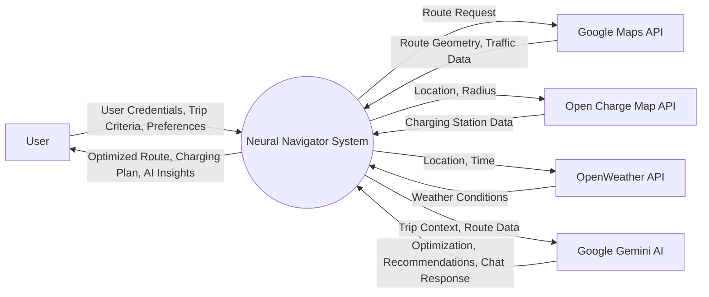
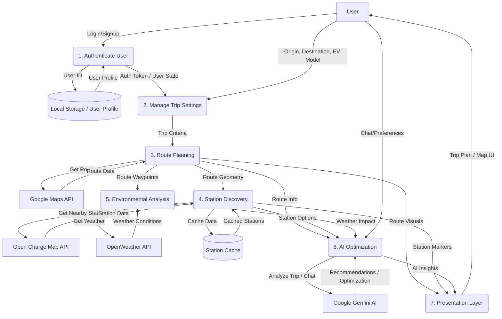

# ⚡ EaseNavigator AI: Intelligent EV Trip Optimization

> **Smart, sustainable, and data-driven travel for electric vehicle users.**

EaseNavigator AI is an intelligent route planner built for electric vehicle (EV) users.  
It combines routing, charging-station data, weather-aware energy predictions, and optional AI recommendations to plan the most efficient and eco-friendly trip possible — while keeping users informed about charging stations, traffic, and environmental conditions along the way.

---

##  Key Features


### Immersive Route Experience
- **Cinematic 3D Flyover**: Experience a stunning preview of your route with simulated drone footage alongside the live map.
- **Full-Responsive Map**: A dynamically resizing map engine (450px on mobile, 600px+ on desktop) that ensures optimal visibility on any device.
- **Interactive Controls**: Deep integration with traffic layers, incidents, and points of interest.

### Next-Gen Journey Timeline
- **"Heads-Up" Journey Plan**: A distinct, horizontal timeline view that separates your itinerary from the map for clarity.
- **Dynamic Battery Visualization**: Real-time SOC (State of Charge) indicators with color-coded alerts (Green/Yellow/Red) based on battery health.
- **Interactive Stop Cards**: Detailed "Stop Boxes" showing amenities, wait times, and charging speeds—now fully responsive and compact.

###  Stable Data Simulation
- **Consistent World State**: Amenities (Restrooms, WiFi, Food) and Traffic Levels are pseudo-randomly consolidated. Revisiting a station always yields the same data, preventing "flicker" and ensuring a realistic demo experience.
- **Traffic Estimate (simulated)**: Traffic levels and incidents are sample data and are labelled as such in the app. Live traffic isn't connected yet.
- **Station details (simulated)**: Availability, wait times, prices and amenities are estimates, seeded per station so they stay consistent. Station locations and power ratings are real (OpenChargeMap).

###  My Garage
- **Vehicle Management**: Save and manage your preferred EV model with real-time range and battery capacity tracking.
- **Battery Health Tracking**: Adjust for battery degradation to get even more accurate range estimates.

###  Premium UI/UX
- **Glassmorphism Design**: Modern, translucent interface elements that float over the content.
- **Responsive Layouts**: A grid system that intelligently stacks mapping and timeline components for mobile users while expanding for desktop dashboards.

---

## System Architecture (DFD)

### Context Diagram (Level 0)
The system aggregates data from multiple external sources (Google Maps, Open Charge Map, OpenWeather) and processes it through the Gemini AI Engine to provide optimized trip plans.



### Data Flow Diagram (Level 1)
Detailed breakdown of how user inputs flow through the routing engine, station discovery, and AI optimization layers.



---

##  Tech Stack

| Area | Technology | Description |
|------|-------------|-------------|
| **Frontend** | React + TypeScript | Modular, scalable, and type-safe UI |
| **AI Engine** | Google Gemini (2.5 Flash) | Natural language parsing and intelligent recommendations |
| **Mapping** | Google Maps Platform | Advanced markers, directions, and 3D vector maps |
| **Routing** | OSRM (Open Source Routing Machine) | Optimized driving routes with multiple alternatives |
| **Geocoding** | Nominatim (OpenStreetMap) | High-accuracy address resolution |
| **Charging Data** | OpenChargeMap API | Comprehensive global database of charging stations |
| **Weather** | OpenWeatherMap (simulated fallback) | Real-time weather impact analysis |
| **Styling** | Tailwind CSS | Modern, responsive, and aesthetic design |

---

##  Setup & APIs

Copy `.env.example` to `.env` and fill in your keys:

| Variable | Where it's used | Exposed to the browser? |
|----------|-----------------|-------------------------|
| `VITE_GOOGLE_MAPS_API_KEY` | Google Maps JS (map, directions, elevation) | Yes, this is required by Maps. Restrict it to your domains in Google Cloud Console. |
| `VITE_GOOGLE_MAPS_MAP_ID` | Optional Map ID for vector/3D styling | Yes |
| `VITE_OPENWEATHER_API_KEY` | Optional live weather; simulated if unset | Yes |
| `OCM_API_KEY` | OpenChargeMap charging stations | **No**, added server-side by `/api/ocm` |
| `GEMINI_API_KEY` | Gemini AI recommendations & assistant | **No**, added server-side by `/api/gemini` |
| `ALLOWED_ORIGINS` | Optional extra domains allowed to call `/api/*` | No |
| `UPSTASH_REDIS_REST_URL`, `UPSTASH_REDIS_REST_TOKEN` | Optional shared rate limiting for `/api/*` | No |

Secret keys (no `VITE_` prefix) are never bundled into the frontend. In development the Vite dev
server proxies `/api/ocm` and `/api/gemini` and injects them; in production the Vercel functions in
`api/` do the same. If `GEMINI_API_KEY` is missing, the app falls back to local heuristics. Without
`VITE_GOOGLE_MAPS_API_KEY` the app still works and shows a "Map unavailable" panel instead of the map.

**API protection.** `/api/gemini` and `/api/ocm` only answer requests from your own site and limit each
visitor (30 AI requests and 60 station lookups per minute). Set the Upstash variables to share those
limits across all serverless instances; otherwise each instance counts separately. Address search
(Nominatim) is limited to 1 request per second and cached, as its usage policy requires.

###  Installation

1. **Clone the repo**
   ```bash
   git clone https://github.com/MayankParashar28/EaseNavigator.git
   cd EaseNavigator
   ```

2. **Install dependencies**
   ```bash
   npm install
   ```

3. **Run the development server**
   ```bash
   npm run dev
   ```

4. **Check the code** (type-check, lint, tests)
   ```bash
   npm run typecheck && npm run lint && npm test
   ```
   The same checks run in GitHub Actions on every pull request.

###  Deploying to Vercel

Add the same variables under **Project → Settings → Environment Variables**. `OCM_API_KEY` and
`GEMINI_API_KEY` are read only by the serverless functions in `api/`.

###  Accounts (demo mode)

Sign-in is local only: there is no backend, and passwords are not stored or verified. Each email gets
its own profile (trips, garage, preferences) saved in that browser's `localStorage`. Without signing in,
the app runs as a guest profile.

---

##  Project Structure

```text
EaseNavigator/
├── api/
│   ├── ocm.ts                     # Serverless proxy: OpenChargeMap (holds key)
│   └── gemini.ts                  # Serverless proxy: Gemini (holds key)
├── src/
│   ├── components/
│   │   ├── NeuralAssistant.tsx    # AI Voice/Text command center
│   │   ├── RouteMap.tsx           # Map container (layers, markers, panels)
│   │   ├── route-map/             # Map sub-modules: flyover, overlays, clustering
│   │   ├── TripPlanner.tsx        # Main orchestration logic
│   │   ├── TripResults.tsx        # Analytics & bento-grid stats
│   │   └── UserPreferences.tsx    # "My Garage" management
│   ├── lib/
│   │   ├── ai.ts                  # Gemini integration layer
│   │   ├── openData.ts            # Cached, throttled Nominatim + OSRM
│   │   ├── weatherService.ts      # Environmental calculations
│   │   └── localStorage.ts        # Persistent storage & local profiles
│   └── main.tsx                   # App entry
└── package.json                   # Project configuration
```
